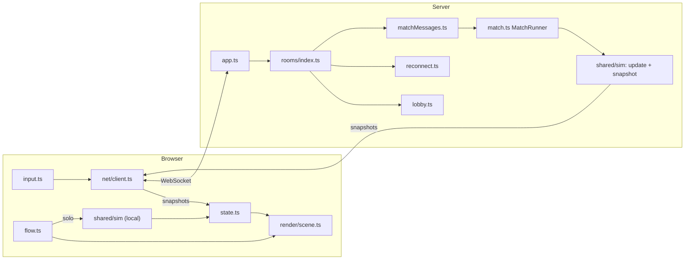

# Arcane Duel

Browser-based wizard duel for two players, or 2 v 2 teams (Magicka-style elemental spellcasting).
Runs on HTML5 canvas, with a Node.js WebSocket server for online play.

## Code map

One line per folder. Paths are from the repo root; `<x>` is a name you fill in.

```
client/               The browser game (Vite bundle). index.html is markup only.
  src/                TypeScript, one folder per job:
    main.ts           Start-up: wires the menus, the socket and the game loop together.
    flow.ts           The frame loop; start, finish and pause a match (solo runs shared/sim here).
    input.ts          Keyboard and mouse -> the local sim (solo) or messages (online).
    state.ts, dom.ts  The shared `game` / `net` state; the canvas `ctx` and page elements.
    settings.ts       Saved player settings.
    net/              client.ts (socket, messages, reconnect), session.ts (saved room for refresh),
                      clock.ts, movePrediction.ts (your wizard), prediction.ts (your spell previews),
                      shotExtrapolation.ts, earthVisibility.ts.
    render/           Canvas 2D drawing.
      scene.ts        The draw order of a frame.      shapes.ts  Shared drawing helpers.
      camera.ts, fog.ts, interpolate.ts, resolution.ts   Camera, fog of war, smoothing, canvas size.
      world/          Things in the arena:
        wizard/       One file per part of a wizard (hats, staff, body, offhand, sword, overhead, statusEffects).
        projectiles/  One file per spell family in flight (fireball, ice, shards, steam, ...).
        bombs/        One file per element's bomb (fire, ice, water, ...); index.ts picks.
        zones.ts, death.ts, controlEffects.ts   Ground zones, death animation, freeze/stun looks.
      arena/          Map art and the map picker (maps.ts, ruins.ts, scenery.ts, pillars, chunks).
      effects/        particles.ts, lightning.ts.
      hud/            minimap, team panel, start countdown.
    fx/cosmetics.ts   Turns server fx events into particles, floating text, arcs and rings.
    ui/               theme.css (tokens), components.css (.ui-*), page.css (header, stage, hidden screens).
      menus/          Menu code and its stylesheet side by side (menu, lobby, settings, spellbook, results).
      hud/            The in-match DOM HUD: hud.ts, hud.css, action bar, cooldowns, away overlay.
    workshop/         The Wizard Workshop: panel, parts, preview, layout editor, saved looks, workshop.css.
    audio/            Music players and track lists.
    loop/fixedStep.ts The fixed 60 Hz step used by the frame loop.
  styleguide.html     The live style guide (/styleguide.html), a second Vite page.
  public/art/         Menu art (menu/), results art (results/), Workshop sprites (workshop/).
  public/spells/      Spell and element icons.
server/               Node HTTP + WebSocket server.
  index.ts, app.ts    Boot; the http/WebSocket server, rate limit, /stats.
  rooms/              index.ts (routes each message), state.ts (rooms, codes, tokens), lobby.ts (create,
                      join, seats, options, start), reconnect.ts (drops, resume), matchMessages.ts
                      (inputs, rematch, back to lobby).
  match.ts            MatchRunner: the 60 Hz loop, snapshots at 30 Hz, pause/resume.
  validate.ts, static.ts, stats.ts, latency.ts   Message checks; static files; /stats; test-only lag.
shared/               Code both sides use (pure TypeScript, no DOM).
  sim/                The game rules. update/ is the tick (shots, bombs, zones, players, ai, deaths);
                      combat/ is what spells do (cast, damage, projectiles, beams, areas, traps,
                      reflect, knockback, abilities, variantCasts); also movement, obstacles, vision,
                      snapshot (what players are sent), teams, variants, wizard, input, effects, match.
  protocol.ts         Message types for the WebSocket, PROTOCOL_VERSION.
  constants.ts        Tuning numbers.    charge.ts  Charged-spell rules.
  maps.ts, ruinsMap.ts  Map data (size, spawns, vision, solids; no art).
  simState.ts, types.ts, math.ts, random.ts   Match state, shared types, helpers.
tests/                npm test: sim/, client/, server/. Also browser and load scripts (*.mjs, see Tests).
scripts/              check-version.mjs; screenshots.mjs; render-trace/ and sim-trace/ (refactor checks).
deploy/               Oracle Cloud server scripts (setup.sh, caddy.sh, arcane-deploy).
.githooks/            Format on commit, checks on push (turned on by `npm install`).
docs/                 HANDOFF.md (where things stand, start here), WORKFLOW.md (how Jesse and Mark share
                      the repo), ARCHITECTURE.md (how it works), UI.md (menu components), BUBBLES.md,
                      REFACTOR-ISSUES.md (open findings), ROADMAP.md, MAPS-PLAN.md, TEAMS-PLAN.md,
                      TEST-CHECKLIST.md (manual tests), INVESTIGATION.md (lag), DEPLOY-ORACLE.md.
AGENTS.md             The short rules for AI assistants (CLAUDE.md just points to it).
dist/                 GENERATED by `npm run build`. Gitignored. Never edit.
```

### How the parts fit



### Where do I change...?

| I want to change               | Go to                                                                                                  |
| ------------------------------ | ------------------------------------------------------------------------------------------------------ |
| A spell's damage or tuning     | `shared/constants.ts` (`COMBO_DAMAGE`, ...) and `shared/sim/combat/` (`damage.ts`, `projectiles.ts`)   |
| How a spell looks in flight    | `client/src/render/world/projectiles/` (one file per spell or variant: `storm.ts`, `fireball.ts`, ...) |
| How a bomb looks               | `client/src/render/world/bombs/<element>.ts`                                                           |
| A wizard's hat, staff or body  | `client/src/render/world/wizard/hats.ts` (`staff.ts`, `body.ts`, ...)                                  |
| A menu screen's layout         | `client/src/ui/menus/<screen>.css` and `client/index.html`                                             |
| Buttons and colours everywhere | `client/src/ui/theme.css` and `components.css`                                                         |
| Add or change a map            | `shared/maps.ts` (data) and `client/src/render/arena/` (art, picker)                                   |
| Room and lobby rules           | `server/rooms/lobby.ts`                                                                                |
| Disconnect handling            | `server/rooms/reconnect.ts` and `client/src/net/session.ts`                                            |
| What players are sent          | `shared/sim/snapshot.ts` (message types: `shared/protocol.ts`)                                         |
| Particles, floating text, arcs | `client/src/fx/cosmetics.ts`                                                                           |
| The Wizard Workshop            | `client/src/workshop/`                                                                                 |

## Run locally

1. Install Node.js 20 or newer.
2. `npm install` (its `postinstall` also builds; deploys rely on this)
3. `npm start`
4. Open `http://localhost:3036` (override with the `PORT` env var).
5. Click **Create Private Room**: the lobby shows the six-letter code (with a copy button), the map
   (arenas and battlegrounds), the team size (1 v 1 up to 4 v 4), and for team matches friendly fire and what
   happens when a wizard falls. Friends join with the code from the same server URL (they fill the seats
   across the two teams; you can move them with the ⇄ buttons), then you press **Start**.

After changing code, run `npm run build` and restart. For client development with hot reload, run
`npm run dev:server` and `npm run dev` together and open the Vite URL.

Optional lag simulation (one-way delays in ms, test only):
`ARCANE_LATENCY_MS=70 ARCANE_LATENCY_IN_MS=70 ARCANE_JITTER_MS=10 npm start`

## Tests

- `npm test`: unit tests (simulation, snapshots, prediction, server, validation).
- `npm run typecheck`: TypeScript for client and server.
- `npx prettier --check .`: formatting (`npm run format` fixes it). Git hooks run these for you.
- `npm run check-version`: the version is the same everywhere it lives.
- `node scripts/screenshots.mjs <label>` then `--compare <before> <after>`: builds, opens every screen
  (menu, settings, spellbook, Workshop, lobby, a solo match, pause, results, style guide) with a frozen
  clock and seeded randomness, and reports any pixel that changed (images in `screenshots/`, gitignored).
  Run it before and after any client refactor.
- `TRACE_LABEL=<label> npx vitest run --config scripts/render-trace/vitest.config.mts`, then
  `node scripts/render-trace/compare.mjs <before> <after>`: records every canvas call the renderer makes for
  ~330 cases (every wizard style and status, every spell's shots and bombs, every map) and reports the first
  difference. Proves a render refactor draws exactly the same thing.
- `TRACE_LABEL=<label> npx vitest run --config scripts/sim-trace/vitest.config.mts`, then
  `node scripts/sim-trace/compare.mjs <before> <after>`: runs 586 scripted matches (every spell and variant
  against shields, bubbles and dummies, AI duels on every map, 2v2 to 4v4 with every rule) and reports the first
  tick where the simulation differs. Proves a sim refactor changes no gameplay.
- After `npm run build`, the browser and load scripts (need Playwright's Chromium:
  `npx playwright install chromium`, plus `sudo npx playwright install-deps chromium` on Linux):
  - `node tests/smoke.mjs`: solo duel and an online match in headless Chromium (server must be running).
  - `node tests/feel.mjs [good,typical,bad,steady]`: how smooth movement looks under simulated networks.
  - `node tests/lag-trace.mjs [dir] [profile]`: key press to what each screen shows, on one clock.
  - `node tests/stop-trace.mjs [profile]`: key release to the server stopping the wizard (no browser).
  - `node tests/latency.mjs`: input/spell confirmation times (start the server with `ARCANE_LATENCY_MS`).
  - `node tests/load.mjs [rooms] [seconds] [map] [scenario] [teamSize]`: server CPU and bandwidth with many
    rooms (any map; scenario `wander` or `meet`; team size 1 to 4).

## Deployment

Hosted on an Oracle Cloud Always Free VM in Sydney (about 50 ms from Perth), with three slots:
`main` on the plain IP and two test slots for any branch. Pushes deploy automatically. See
`docs/DEPLOY-ORACLE.md`.

Play online at the server IP `159.13.37.255` (plain HTTP, WebSockets over `ws://`):

| Slot    | URL                          | Port | Runs                                 |
| ------- | ---------------------------- | ---- | ------------------------------------ |
| `main`  | `http://159.13.37.255/`      | 80   | always `main`                        |
| `test1` | `http://159.13.37.255:8081/` | 8081 | whatever was deployed                |
| `test2` | `http://159.13.37.255:8082/` | 8082 | whatever was deployed                |
| `test3` | `http://159.13.37.255:8083/` | 8083 | whatever was deployed (`test-adnan`) |

Any host with persistent processes and WebSocket support works (`npm install` builds, `npm start`
runs); on the VM, Caddy serves the built client and Node handles the game traffic.

Live server numbers (rooms, connections, tick time, bandwidth): `http://<host>/stats`.

## Networking model

Server-authoritative: the server runs one simulation per room at a fixed 60 Hz and both
players are clients. They send their held keys every tick plus actions as they happen, and
receive snapshots at 30 Hz; each client predicts its own movement and draws the opponent
slightly in the past. A dropped connection can reconnect within 10 s. See
`docs/ARCHITECTURE.md` for diagrams and `docs/ROADMAP.md` for measurements.

## Working on it

Jesse works on `test-jesse` and Mark on `test`; both merge the other's branch at the start of a
session and push at the end (`docs/WORKFLOW.md`, `AGENTS.md`). Test on your branch's slot, then open a
pull request into `main`. `npm test`, `npm run typecheck` and `npx prettier --check .` must pass; the
git hooks check them for you.

## Manual testing (for testers and AI assistants)

If you are asked to test the game, or to help someone test it, **read `docs/TEST-CHECKLIST.md` and
run the session from it**: it has the instructions, the ordered checks and a results log. The
checklist grows with every feature (`docs/MAPS-PLAN.md`).
